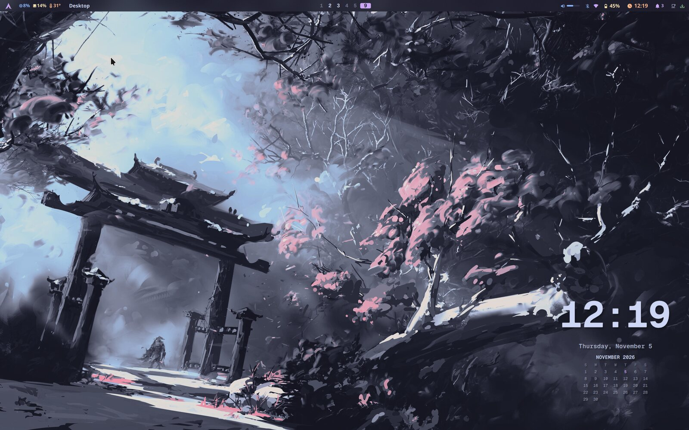
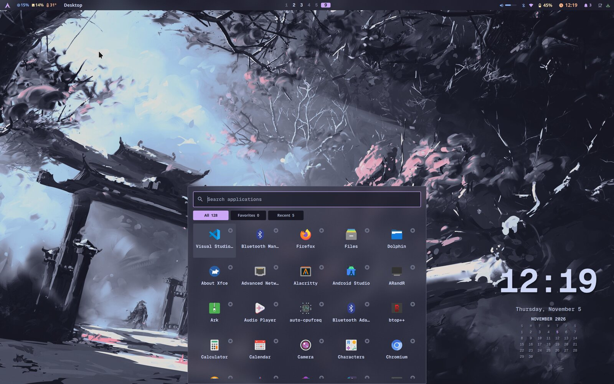
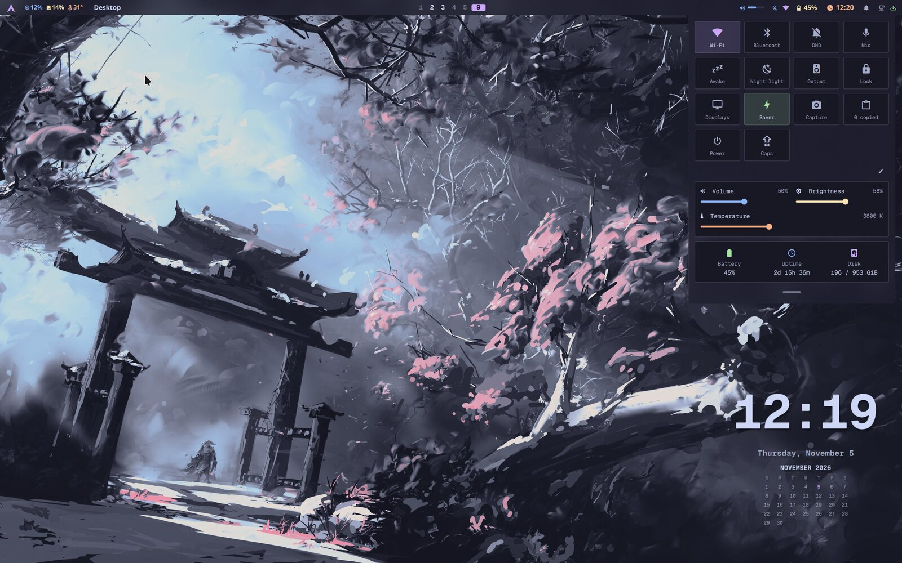
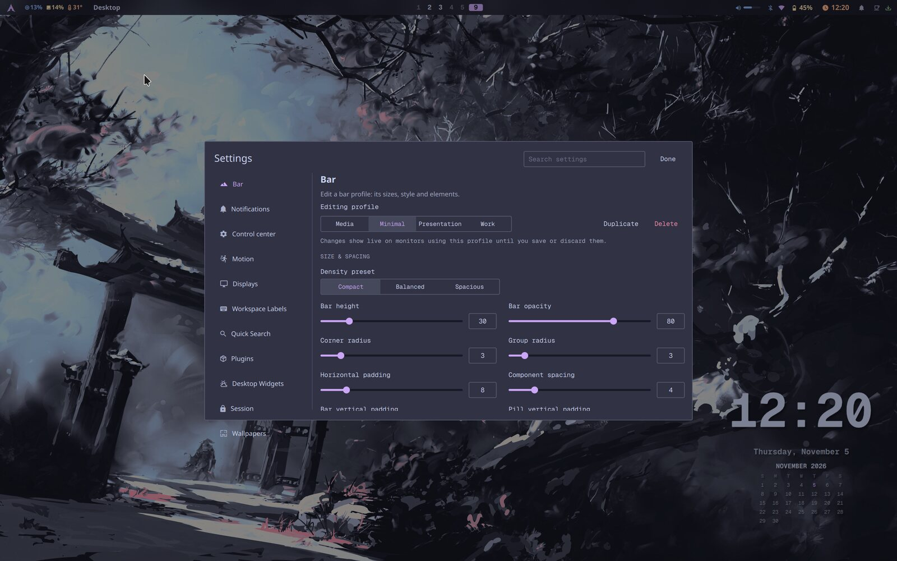
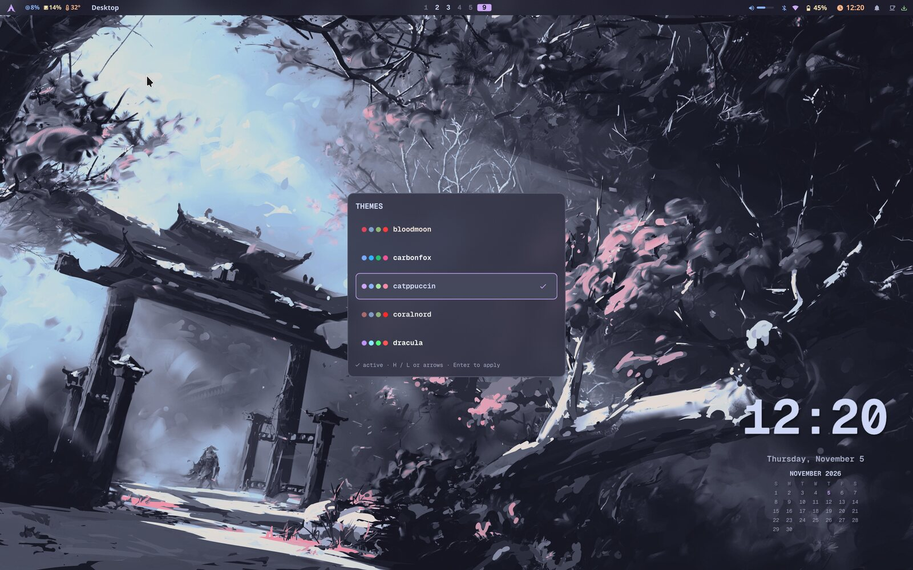
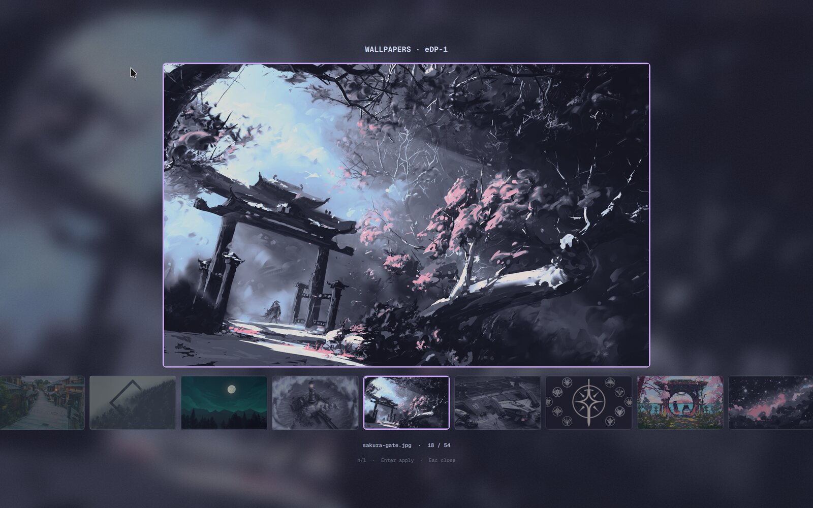

# new-dots

My Arch Linux desktop: [Hyprland](https://hyprland.org) with a custom [Quickshell](https://quickshell.org) shell, 11 colorschemes that switch everything at once, and a bootstrap that sets up a machine from a single command.



## Install

> [!WARNING]
> Arch Linux only. This updates the system, installs packages and replaces your config files. Files in the way are moved to `~/.dotfiles-backup/`, but read [`bootstrap.sh`](bootstrap.sh) before piping it into a shell.

Run it as your normal user, not root. It asks for `sudo` once:

```sh
curl -fsSL https://raw.githubusercontent.com/ndrolp/new-dots/main/bootstrap.sh | bash
```

It clones this repo to `~/.dotfiles` and runs from there, so running the same line again updates the clone first. The log goes to `~/.local/state/dotfiles/`.

To pass options, add them after `bash -s --`:

```sh
curl -fsSL https://raw.githubusercontent.com/ndrolp/new-dots/main/bootstrap.sh | bash -s -- --minimal
```

| Option | What it does |
| --- | --- |
| `--host <name>` | Use `host-<name>` instead of the machine's hostname |
| `--minimal` | Skip the apps package group |
| `--stow-only` | Only link the config files, install nothing |
| `--no-system` | Skip enabling services and changing the login shell |
| `--spicetify` | Also install spicetify |
| `--help` | Show this help |

The clone's `origin` is switched to SSH, so add an SSH key to GitHub before you push.

## Screenshots

| | |
| --- | --- |
|  |  |
| **App launcher** | **Control center** |
|  |  |
| **Settings panel** | **Colorscheme picker** |



The wallpaper images aren't part of this repo.

## Keybinds

| Keys | Action |
| --- | --- |
| `Alt` + `Return` | Terminal |
| `Alt` + `D` | App launcher |
| `Alt` + `F` | Unified search |
| `Alt` + `C` | Control center |
| `Alt` + `P` | Settings panel |
| `Alt` + `V` | Clipboard history |
| `Alt` + `Shift` + `B` | Wallpaper selector |
| `Alt` + `Shift` + `X` | Screen capture |
| `Alt` + `Shift` + `E` | Power menu |
| `Super` + `T` | Colorscheme picker |
| `Super` + `A` | App menu at the cursor |

## Layout

```text
.
├── bootstrap.sh     # sets up a machine; --help lists the flags
├── common/          # config for every machine, linked into $HOME with stow
│   ├── .config/     # hypr, quickshell, kitty, ...
│   ├── bootstrap/   # the bootstrap's steps and tests
│   └── packages/    # package groups: core, apps, hardware
├── host-sodoma/     # config for one machine, linked over common/
├── colorschemes/    # one folder per colorscheme
├── scripts/         # scripts/test-all runs every test suite
└── wallpapers/      # rofi wallpaper picker
```

Add a machine with a `host-<hostname>/` folder.
